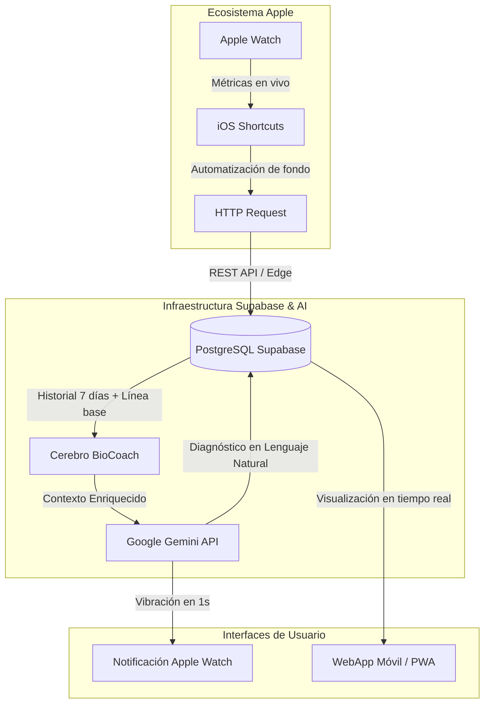

# 🧬 BioCoach AI

> Sistema autónomo de bio-tracking, optimización de recuperación y entrenamiento inteligente que integra **Apple Watch**, **PostgreSQL en Supabase** y modelos **Google Gemini** para análisis fisiológico personalizado en tiempo real.

---

## 🌟 Visión del Proyecto

BioCoach AI elimina la fricción manual de las aplicaciones de salud tradicionales. Utiliza la telemetría pasiva de los sensores de **Apple Watch** y los disparadores nativos de **Apple Shortcuts** para registrar, procesar y analizar eventos biométricos clave a lo largo del día, manteniendo una memoria histórica continua en la nube sin costo de infraestructura.



---

## 🛠️ Stack Tecnológico

* **Dispositivo de Captura:** Apple Watch (Series 4+) & Apple HealthKit.
* **Automatización del Sistema:** iOS Personal Automations & Shortcuts.
* **Base de Datos & Backend:** PostgreSQL en Supabase con Row Level Security (RLS).
* **Motor de Razonamiento:** Google Gemini (Gemini 1.5/2.0 Flash & Pro).
* **Frontend Móvil:** WebApp progresiva (PWA) instalable en iPhone.

---

## 🗺️ Roadmap de Implementación

- [x] **Fase 1: Infraestructura y Base de Datos**
  - [x] Diseño relacional para series temporales (`daily_recovery`, `workouts`, `nutrition_logs`, `hr_checkins`).
  - [x] Políticas de seguridad Row Level Security (RLS).
  - [x] Estructura base del repositorio y aislamiento de credenciales.
- [ ] **Fase 2: Motor de Cálculo Fisiológico y Orquestador de Gemini**
  - [ ] Algoritmo de media móvil para VFC (HRV) y frecuencia en reposo.
  - [ ] Cálculo de deuda de sueño y ratio de fatiga aguda/crónica.
  - [ ] Integración con la API de Gemini mediante prompts estructurados.
- [ ] **Fase 3: Atajos de iOS Automatizados**
  - [ ] Atajo de recuperación matutina (disparo al apagar alarma/sueño).
  - [ ] Atajo post-entrenamiento con cálculo de zonas de pulso.
  - [ ] Atajo a demanda para chequeo de palpitaciones/estrés.
  - [ ] Atajo de dictado por voz para nutrición.
- [ ] **Fase 4: WebApp PWA**
  - [ ] Dashboard interactivo de tendencias semanales y mensuales.
  - [ ] Chat interactivo con el Coach (Gemini con memoria total en base de datos).

---

## 🔒 Seguridad y Manejo de Claves

Este repositorio implementa estrictas directrices de seguridad:
* **Ninguna clave de API ni secreto se versiona en Git.**
* El archivo `.env` está expresamente excluido en el `.gitignore`.
* Las consultas públicas de cliente emplean exclusivamente la clave *Publishable* de Supabase protegida por políticas RLS.

---

## 🚀 Inicio Rápido

### Requisitos previos
* Python 3.9+
* Proyecto activo en [Supabase](https://supabase.com/)
* API Key de [Google AI Studio](https://aistudio.google.com/)

### Configuración local
```bash
# 1. Clonar el repositorio
git clone <URL_DEL_REPOSITORIO>
cd bio-coach

# 2. Configurar variables de entorno
cp .env.example .env

# 3. Editar .env con tus credenciales
# SUPABASE_URL=...
# SUPABASE_PUBLISHABLE_KEY=...
# GEMINI_API_KEY=...

# 4. Verificar conectividad
python scripts/test_connection.py
```

---

## 📄 Licencia

MIT © Jose Manuel Martinez (JoseMMC99)
